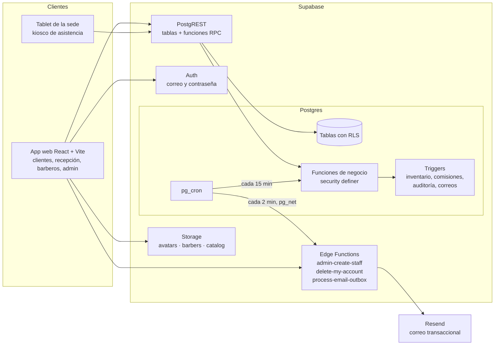

# 1. Arquitectura

## Visión general

**Decisiones clave**

1. **La base de datos es la que manda.** Las reglas que no se pueden romper viven en Postgres, no en el frontend: un barbero no puede tener dos citas cruzadas (restricción `EXCLUDE`), el inventario nunca queda negativo (`CHECK` + trigger), la comisión se congela al cobrar y un usuario no puede cambiar su propio rol (trigger). Así, aunque alguien llame la API directamente, los datos siguen siendo correctos.
2. **Lecturas con RLS, escrituras sensibles con RPC.** El frontend lee tablas y vistas directamente (la RLS filtra lo que cada rol puede ver). Las operaciones con varias reglas (reservar, cobrar, marcar asistencia, cerrar quincena) son funciones `security definer` que validan permisos y ejecutan todo en una sola transacción.
3. **Patrón outbox para correos.** Los triggers solo encolan el correo en `email_outbox`; una Edge Function lo envía. Si Resend falla, el correo se reintenta hasta 3 veces y la reserva no se pierde.
4. **Todo en hora de Colombia.** Las fechas se guardan en `timestamptz` (UTC) y los cálculos de agenda, quincenas y reportes usan la zona `America/Bogota` configurable en `app_settings`.
5. **Reglas del negocio configurables.** Anticipación mínima, ventana de cancelación, intervalo de la agenda, tolerancia de llegada, comisiones por defecto y descuento máximo están en `app_settings`, no en el código.

## Roles

| Rol | Quién es | Qué hace |
|---|---|---|
| `admin` | Propietario y administradora | Todo: catálogo, personal, comisiones, anulaciones, panel de ambas sedes |
| `receptionist` | Recepción de cada sede | Agenda, clientes de mostrador, caja, inventario y kiosco **de su sede** |
| `barber` | Barberos | Su agenda, sus clientes, sus comisiones, su presentación pública |
| `client` | Clientes registrados | Reservar, reprogramar y cancelar sus citas; editar sus datos; eliminar su cuenta |

Quien se registra desde la app siempre es `client`. Los roles de personal solo los asigna un admin con la Edge Function `admin-create-staff`.

## Trazabilidad con los requerimientos de la Fase 2

| Req. | Descripción corta | Implementación |
|---|---|---|
| RF01 | Registrar, editar y desactivar barberos | `barbers`, `barber_compensation`, Edge Function `admin-create-staff` |
| RF02 | Horario semanal y novedades | `barber_schedules`, `barber_time_off`, `branch_closures` |
| RF03 | Marcación con PIN en tablet | `register_attendance()`, `get_kiosk_board()`, `barber_credentials` (bcrypt) |
| RF04 | Reporte de horas, retrasos y ausencias | `attendance_report()`, `record_attendance_manual()` |
| RF05 | Catálogo de servicios | `services`, `service_categories`, `barber_services`, bucket `catalog` |
| RF06 | Productos y stock por sede | `products`, `product_stock`, `inventory_movements`, `register_stock_entry()`, `adjust_stock()`, `transfer_stock()` |
| RF07 | Alerta de stock mínimo | Vista `v_low_stock`, `dashboard_summary().low_stock_count` |
| RF08 | Reserva en línea sin dobles reservas | `get_available_dates()`, `get_branch_availability()`, `get_available_slots()`, `book_appointment()`, restricción `appointments_no_overlap` |
| RF09 | Confirmación, recordatorio y cancelación | `email_outbox`, `enqueue_appointment_reminders()`, Edge Function `process-email-outbox`, `cancel_appointment()` con ventana de 2 h |
| RF10 | Clientes sin cita y reservas por teléfono | `staff_upsert_customer()`, `staff_create_appointment()` |
| RF11 | Autorización de datos y eliminación de cuenta | `customers.data_consent_at`, `handle_new_user()`, Edge Function `delete-my-account`, `anonymize_customer()` |
| RF12 | Registrar servicios y ventas | `create_sale()`, `void_sale()` |
| RF13 | Comisiones quincenales | `sale_items.commission_amount`, `commission_summary()`, `close_commission_period()` |
| RF14 | Panel de indicadores | `dashboard_summary()` |
| RF15 | Exportar ventas a CSV | Vista `v_sales_export` |
| RF16 | Inicio de sesión por rol | Supabase Auth + `profiles.role` + RLS |
| RNF03 | Seguridad | RLS en las 26 tablas, funciones con `search_path` vacío, PIN en bcrypt |
| RNF05 | Respaldo diario | Plan Pro de Supabase (copias de seguridad diarias) |
| RNF06 | Privacidad (Ley 1581) | Consentimiento versionado, supresión con anonimización, `audit_log` |
| RNF07 | Mantenibilidad | Migraciones versionadas, pruebas automáticas, código documentado |
