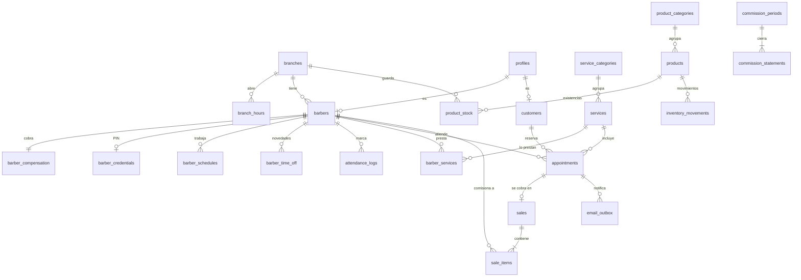
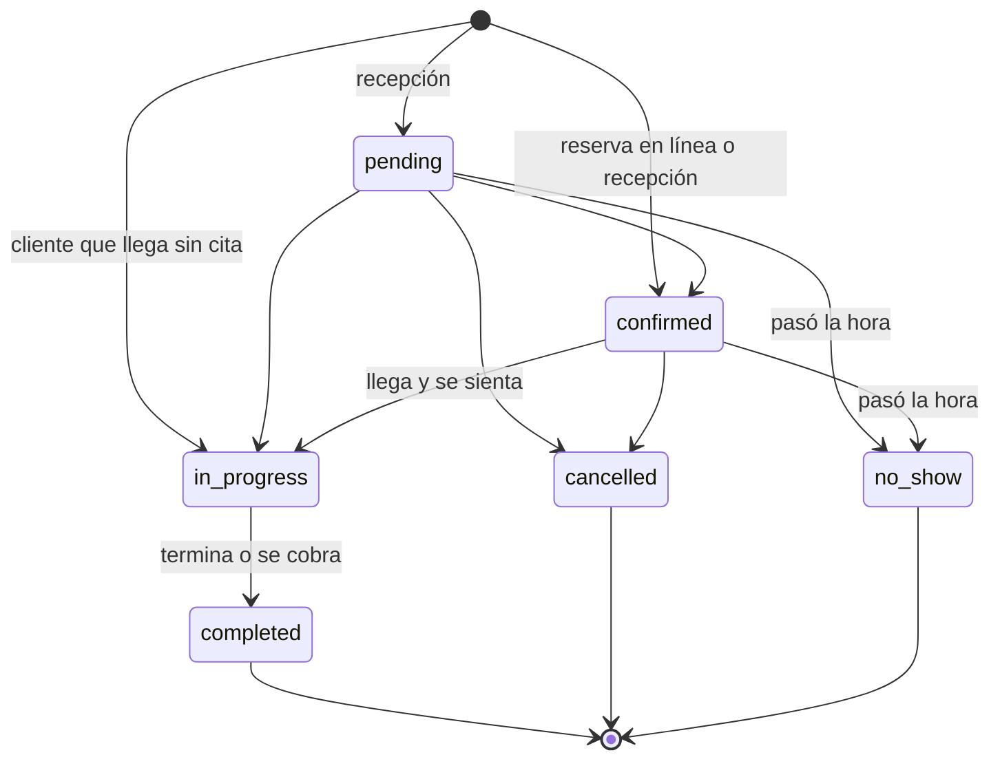

# 2. Modelo de datos

## Diagrama entidad-relación (núcleo)

## Tablas

| Tabla | Para qué sirve | Notas |
|---|---|---|
| `app_settings` | Reglas del negocio editables | `is_public` decide si el cliente puede leerlas |
| `branches` | Sedes | `slug` para URLs (`/sedes/la-castellana`) |
| `branch_hours` | Horario de apertura por día | 0 = domingo … 6 = sábado |
| `branch_closures` | Festivos y cierres | `branch_id` nulo = todas las sedes |
| `profiles` | Un perfil por usuario de Auth | Rol y sede; el usuario no puede cambiarlos |
| `customers` | Clientes con o sin cuenta | Consentimiento Ley 1581 con fecha y versión |
| `barbers` | Ficha pública del barbero | Bio, foto, especialidades, color de agenda |
| `barber_compensation` | % de comisión por servicio y producto | Solo la ven el admin y el propio barbero |
| `barber_credentials` | PIN del kiosco en bcrypt | Sin acceso desde la API |
| `barber_schedules` | Horario semanal y almuerzo | Un registro por día trabajado |
| `barber_time_off` | Permisos, incapacidades, vacaciones | Bloquea la agenda en ese rango |
| `attendance_logs` | Entradas y salidas | Solo se crean por función (kiosco o corrección justificada) |
| `service_categories`, `services` | Catálogo de cortes y servicios | Duración en múltiplos de 5 min |
| `barber_services` | Qué servicio presta cada barbero | Filtra la disponibilidad |
| `product_categories`, `products` | Productos de venta | SKU único, costo y stock mínimo |
| `product_stock` | Existencias actuales por sede | Nunca negativas; solo las cambia un movimiento |
| `inventory_movements` | Compras, ventas, ajustes, mermas, traslados | Inmutables (no se editan ni se borran) |
| `appointments` | Citas | Precio congelado; restricción anti cruces |
| `sales`, `sale_items` | Caja | Consecutivo interno, comisión congelada por ítem |
| `commission_periods`, `commission_statements` | Quincenas cerradas | Estado de cuenta inmutable por barbero |
| `email_outbox` | Correos por enviar | Reintentos y error del último intento |
| `audit_log` | Quién cambió qué y cuándo | Ventas, citas, asistencia, precios, roles |

## Vistas

| Vista | Uso |
|---|---|
| `v_appointments` | Agenda con nombres de cliente, barbero, servicio y sede; respeta la RLS de quien consulta |
| `v_low_stock` | Productos en o por debajo del stock mínimo por sede |
| `v_sales_export` | Ventas línea por línea para exportar a CSV (facturación electrónica) |

## Estados de una cita

Cobrar una cita con `create_sale()` la pasa automáticamente a `completed`.

## Movimientos de inventario

| Tipo | Signo | Quién lo genera |
|---|---|---|
| `purchase` | + | Recepción o admin (`register_stock_entry`) |
| `sale` | − | El sistema al vender un producto |
| `return` | + | El sistema al anular una venta |
| `adjustment` | ± | Conteo físico (`adjust_stock`) |
| `waste` | − | Merma, vencido o dañado |
| `transfer_out` / `transfer_in` | − / + | Traslado entre sedes (solo admin) |
